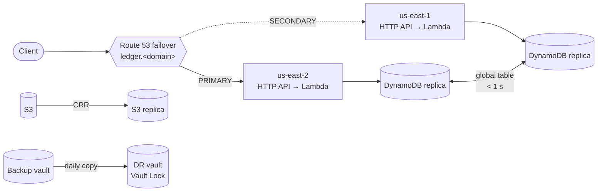

# Multi-Region Disaster Recovery on AWS: Measured RTO and RPO

[](https://github.com/Monkmode-tech/aws-multi-region-dr/actions/workflows/ci.yml)


**Roles this project supports:** Cloud Solutions Architect · Cloud Architect · Cloud Engineer · Site Reliability / Cloud DevOps Engineer

## In plain terms (2-minute read)

**The problem.** Cloud providers have regional outages: a whole data-center region becomes
unreachable for minutes or hours. A business that runs in one region is down for the whole
outage, and any data written just before it may be lost. Every DR plan comes down to two
numbers: **how long are we down** (RTO, recovery time objective) and **how much data can we
lose** (RPO, recovery point objective).

**What I built.** A small "ledger" web service (clients record entries and read them back) that
runs in **two AWS regions at once**, Ohio and Virginia, built entirely as code:

- **Automatic failover.** AWS's DNS service checks the main region every 10 seconds. If it stops
  answering correctly, customers are sent to the backup region automatically. Nobody has to wake up
  and flip a switch.
- **Every entry is copied to the second region within about a second**, so the backup region
  already has the data when it takes over.
- **Backups that survive mistakes.** Copying data instantly also copies a mistake instantly. So
  there are also daily backups stored in the second region, locked so they can't be deleted early,
  plus "rewind to any second in the last 35 days" recovery.
- **The backup region costs almost nothing while it waits.** It uses pay-per-request services, so
  the whole two-region setup costs about **$12/month** to keep running.

**Proof, not promises.** A "game day" script deliberately breaks the main region while writing one
entry per second. It **measures** how many seconds customers were affected and checks that
**every confirmed entry** made it to the backup region. Then it repairs the main region and confirms
traffic returns. A second script restores a backup to prove the backups actually work.

**Why it matters to a business**

| Business need | How this project delivers it |
|---|---|
| Stay online when an AWS region fails | Identical stack in two regions + health-checked DNS failover |
| Don't lose customer data | Cross-region database replication (typically < 1 s) + point-in-time recovery |
| Recover from human error or ransomware | Daily backups copied to the other region with a deletion lock |
| Know (not guess) recovery time and data loss | Game-day script measures RTO and RPO and writes a report |
| Keep DR affordable | Serverless standby: about $12/month for both regions, idle |
| Pass an audit | Encryption with customer-managed keys in each region, documented decisions, runbook |

**What this shows about how I work.** I start from business targets (RTO and RPO), pick the
cheapest design that meets them, and then *test* that it does, the way a production team runs
game days. My coursework version recovered within one region. This one survives losing the region.

## Technical summary

- **Compute (both regions):** API Gateway HTTP API (regional custom domain, TLS 1.2, ACM cert per
  region, stage throttling) → Lambda Python 3.12 on arm64 with X-Ray. Its IAM policy is limited to
  the **same-region** table replica, so neither region silently depends on the other.
- **Data:** DynamoDB **global table** (us-east-2 + us-east-1, multi-active, on-demand), KMS CMK per
  region, PITR on each replica, deletion protection. S3 **cross-region replication** of KMS-encrypted
  objects with replication metrics (RTC optional).
- **Traffic:** Route 53 **failover alias records**. `HTTPS_STR_MATCH` health checks probe each region's
  execute-api host. `/health` does a real `GetItem`, so a database failure also fails over. Detection
  takes 10 s × 3. Alarms on health-check status live in us-east-1, where Route 53 publishes its metrics.
- **Backups:** AWS Backup daily plan → **cross-region copy** to a DR vault with **Vault Lock**
  (governance mode, minimum 7 days). DynamoDB advanced backup features enabled. Failed jobs are
  sent to SNS. A scripted **restore drill** proves recovery points restore.
- **Testing:** `gameday.sh` injects a regional fault (Lambda concurrency → 0, or a health-check-only
  fault). A writer posts one sequenced item per second, pinned with `curl --resolve` to whatever the
  zone's **authoritative** name server answers, so local DNS caching can't distort the result. The
  script measures RTO, client-visible write outage and failback, and checks **every acknowledged
  write** against the DR replica (RPO).
- **Quality gates:** terraform fmt/validate, tflint, checkov (every skip justified inline), ruff +
  bandit + unit tests for the API, shellcheck. CI needs no AWS credentials.

## Architecture



Details: [architecture](docs/architecture.md) · [DR strategy](docs/dr-strategy.md) · [runbook](docs/runbook.md) · [cost](docs/cost.md) · [ADRs](docs/adr)

## Results

> From live game days. Full reports with raw write logs are in [`docs/evidence`](docs/evidence).

| Measure | Target | Result |
|---|---|---|
| RTO: fault injected → DR region serving (authoritative DNS) | < 2 min | _pending first game day_ |
| Client-visible write outage | < 2 min | _pending_ |
| RPO: acknowledged writes lost | 0 | _pending_ |
| Cross-region replication lag (smoke test) | < 5 s | _pending_ |
| Restore drill from the DR backup vault | Succeeds | _pending_ |
| Monthly cost, both regions, idle | < $15 | _pending (estimate ≈ $12)_ |

## Quick start

```bash
aws sso login && export AWS_PROFILE=<profile>
cd environments/demo
cp backend.hcl.example backend.hcl
cp terraform.tfvars.example terraform.tfvars   # your domain and email
terraform init -backend-config=backend.hcl
terraform apply
cd ../.. && make smoke                         # both regions + replication lag
make gameday                                   # break the primary, measure, fail back
```

## Where to look

| Skill | Evidence |
|---|---|
| DR strategy selection against RTO/RPO and cost | [docs/dr-strategy.md](docs/dr-strategy.md), [ADR 0001](docs/adr/0001-serverless-warm-standby.md) |
| Multi-region data design trade-offs (RDS vs Aurora Global vs DynamoDB MREC/MRSC) | [ADR 0002](docs/adr/0002-dynamodb-global-tables.md), [`modules/global-table`](modules/global-table/main.tf) |
| DNS failover and health-check design | [`modules/failover-dns`](modules/failover-dns/main.tf), [ADR 0003](docs/adr/0003-route53-failover-vs-arc.md) |
| Multi-provider Terraform (one module deployed to two regions) | [`environments/demo/main.tf`](environments/demo/main.tf), [`modules/regional-api`](modules/regional-api/main.tf) |
| Backup, immutability and restore testing | [`modules/backup`](modules/backup/main.tf), [`scripts/restore-drill.sh`](scripts/restore-drill.sh) |
| Chaos engineering / game days with measured results | [`scripts/gameday.sh`](scripts/gameday.sh) |
| Least privilege and encryption across regions | [`modules/kms`](modules/kms/main.tf), [architecture: security controls](docs/architecture.md#security-controls) |
| Operations | [docs/runbook.md](docs/runbook.md) |

## Certification alignment

| Exam | Areas exercised |
|---|---|
| AWS Solutions Architect – Associate (SAA-C03) | Resilient architectures: multi-region, Route 53 routing policies, DynamoDB global tables, backup strategies, RTO/RPO |
| AWS Solutions Architect – Professional | DR strategy selection, multi-region data replication trade-offs |
| AWS SysOps Administrator / CloudOps Engineer | Health checks, alarms, AWS Backup, restore procedures |
| HashiCorp Terraform Associate | Provider aliases, module reuse, `configuration_aliases`, preconditions |

## Glossary (for non-technical readers)

| Term | Meaning |
|---|---|
| Region | A cluster of AWS data centers in one geographic area (here Ohio and Virginia) |
| Disaster recovery (DR) | The plan and systems that keep a business running when a major failure happens |
| RTO | Recovery time objective: the longest outage the business accepts |
| RPO | Recovery point objective: how much recent data the business can afford to lose |
| Failover / failback | Switching to the backup region / switching back once the main one is fixed |
| Health check | An automated probe that keeps asking "are you working?" |
| Replication | Continuously copying data to another place |
| Warm standby | A fully working backup copy that waits, ready to take over |
| Game day | A planned exercise where the team breaks something on purpose to test recovery |

## Background

Built by **Caleb Tetteh** (M.S. Cloud Computing, UMGC; B.S. Computer Science, Georgia Tech).
It extends the CLCS 645 *Cloud Infrastructure Planning and Design* Unit 4 DR lab. That lab recovered a
WordPress site in one region (us-east-2) by re-registering load-balancer targets, and its report
proposed a warm-standby design in us-east-1 as the next step. This repository builds that next
step and measures it. It also draws on the CLCS 625 Unit 2 resilience architecture design.
