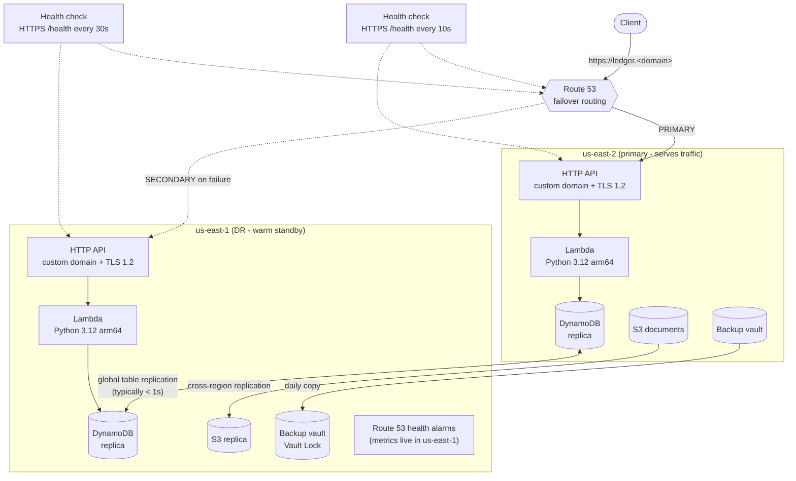

# Architecture

## Request path

1. The client resolves `ledger.<domain>`. While the primary health check passes, Route 53 answers
   with the us-east-2 API custom domain. Otherwise it answers with us-east-1.
2. API Gateway terminates TLS with a regional ACM certificate. Both regions hold their own
   certificate for the same name, validated by the same DNS record. Then it throttles the
   request (20 rps steady, 40 burst) and invokes the regional Lambda.
3. The Lambda reads and writes the DynamoDB replica **in its own region** only. Its IAM policy is
   scoped to that one regional ARN, so a region never silently depends on the other.
4. Every response carries `x-served-by-region`, and every stored item records `written_region`, so
   failover is visible in the data itself.

## Health check design

The health check probes each region's **execute-api hostname**, not the shared name, which would
follow the failover and end up testing the wrong region. `/health` does a real `GetItem` against the
regional table replica, so a broken database in the primary also triggers failover, not just a
crashed function. Detection takes about request interval × failure threshold (10 s × 3).

## Failure modes

| Failure | What happens | Recovery |
|---|---|---|
| Primary Lambda throttled or crashing | /health returns 5xx → failover in ~30 s | Automatic. Fails back when healthy |
| Primary table replica unavailable | /health returns 503 (GetItem fails) → failover | Automatic |
| Bad deploy to the primary only | Health check fails → failover | Roll back. Automatic failback |
| Bad deploy to **both** regions | Both checks fail. Route 53 answers with the primary (fail open) | Roll back. The pipeline should deploy region-by-region |
| Accidental deletes or corruption | Replicated to both regions within ~1 s | PITR restore to a new table, or AWS Backup restore |
| DR region lost while the primary is fine | Secondary health alarm fires. No customer impact | Investigate. Re-deploy DR with Terraform |

## Security controls

| Control | Where |
|---|---|
| Customer-managed KMS key per region (table, Lambda env, logs, SNS, S3, backups), rotation on | `modules/kms` |
| Lambda role limited to Get/Put/Scan on the **same-region** replica | `modules/regional-api` |
| TLS 1.2 minimum on the custom domain. S3 buckets deny non-TLS requests | `modules/regional-api`, `modules/replicated-bucket` |
| Stage throttling against abuse and runaway cost | `modules/regional-api` |
| Table deletion protection + PITR on every replica | `modules/global-table` |
| Cross-region backup copies with Vault Lock (governance mode) | `modules/backup` |
| No AWS keys anywhere. Local runs use SSO, CI needs no credentials | `.gitignore`, `.github/workflows/ci.yml` |
